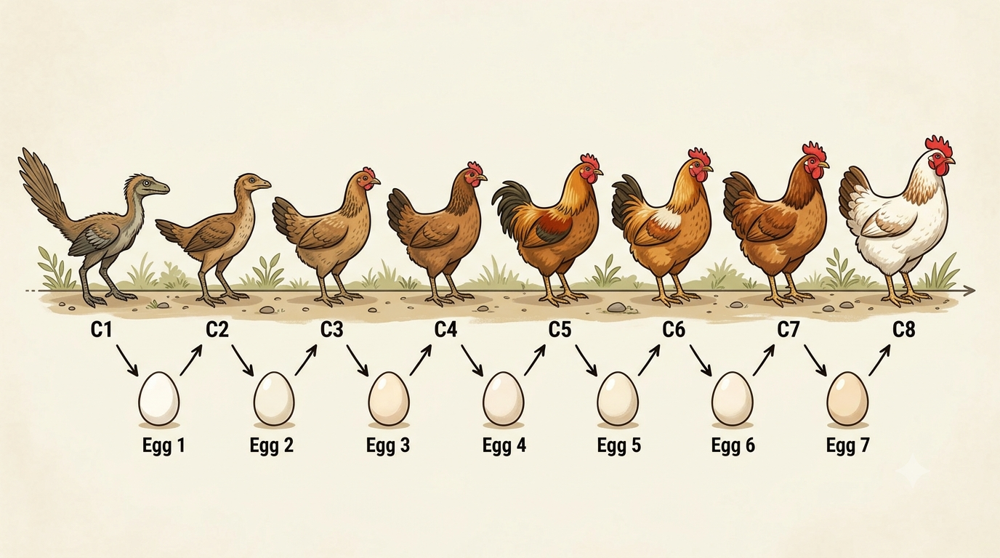

本篇内容来自于父亲的一个问题，我想尝试用哲学方法解决这个问题，从中也可以一窥哲学的思想方法和学理内涵。

## 问题的情况

无论我们是想从哲学的、还是生物学的角度讨论这个问题，我们都有一个共同的图景。那就是，在漫长的鸡的种群延续中，鸡不断地生出蛋，而蛋不断地孵化鸡，如此往复延续。就如下图所示。

容易发现，鸡和蛋是交替的链条。同时，这个链条上的鸡是随着进化论不断演进的，从远古的祖先C1到我们今天的家畜鸡C8，而不同进化阶段的鸡通过“蛋”这个物体而连接起来。

## 为什么是语言问题

既然哲学要想解释和发现真理，那么它就不应该和生物学事实是相悖的。事实上，问题出在于，**什么是“鸡”**？

### 概念的模糊性

我们概念总是模糊的，即，不存在一种确定的边界，可以明确而无含混地区别“属于这个概念的物体”和“不属于这个概念的物体”。一个概念存在他的核心区和模糊的边缘区，由于核心区的存在，也就是那些**典范地**属于该概念的物体，我们可以有意义地使用这个概念并在语言中达到沟通和交流的目的。而边缘区的物体，我们则不能保证正确地下判断。

比如，我们都知道“谷堆”这个概念。那么，堆多少个麦粒才算作一堆呢？直观上来讲，当谷子的数量多到视觉上“凑成一团”的时候才算做一堆，但就算是这样，一堆谷子是不是“谷堆”恐怕也是因人而异、标准各殊的（比如，5粒谷子凑一起，是一小撮，算不算作一堆呢？）一堆谷子拿掉几颗，也仍然是谷堆，但是一直拿掉，总会减少到不再是谷堆的情况，但是这个过程中拿掉任意一粒谷子，都不会在这一步上使谷堆成为非谷堆。

再举一个例子。什么算做体育呢？田径、球类、游泳肯定是体育。那么最近加入奥运会的项目，比如围棋、电竞算体育吗？他们可以是体育，也可以不是体育，总之这是模糊而不定的。

### ”鸡“的模糊性

那么，自然地，在这里，我们说在这个漫长的、渐进的进化链条上，哪些是“鸡”呢？当我们说“鸡生蛋还是蛋生鸡”的时候，我们说的“鸡”到底指什么？
从C1到C4，可以看到鸡逐渐有了我们熟知的形状。但是在千百代的演化中，不存在这样一种情况，他的母亲我们不认为是鸡，而这个蛋一孵出来，我们就认定“它就是第一只鸡”了。[^1]

[^1]: 当然，生物学上，我们仍然可以正确地讲，作为一个被人类驯化并赋予新名字的种群，鸡是大约在 3500 至 4000 年前才开始存在的。不过这仍然是一个**时间段**，而不是**时间点**。

可能有人会反驳，C2不像鸡，C3像鸡，那么C3就是第一只鸡了！并非如此。我们的图片只是示意图，C2和C3之间可能有很多的代际，鸡是**慢慢地**变得像鸡的，哪一只是第一只呢？这是无法确定的。

所以，就这个意义上讲，这是一个无意义的问题。

## 另外一种反驳

考虑这个问题：通过问这个问题，我们期待得到什么样的答案？逻辑上讲，无非这四种：
1. 鸡生蛋
2. 蛋生鸡
3. 既不是鸡生蛋也不是蛋生鸡
4. 既是鸡生蛋也是蛋生鸡

我们分别考虑。1）如果是鸡生蛋，那么鸡肯定是由蛋孵出来的，错误。2）如果蛋生鸡，那么蛋是哪里来的呢？如果是鸡生出的，那么自然错误；如果是由鸡的祖先生出的，那么是一个进化问题，我们刚才已经给出了反驳。4）我们是在溯源“谁是首先”的问题，那么4）自然是矛盾的。

那么剩下的只有3）既不是鸡生蛋也不是蛋生鸡了。

## 问题的回答

所以，“鸡生蛋还是蛋生鸡”这个问题是无意义的，如果非要给出一个回答的话，那也只能是“既不是鸡生蛋也不是蛋生鸡”。

同时，我们问这个问题是想弄清一个真理，就是鸡和蛋到底是什么关系。那么，就这个意义上来讲，弄清上面的那张图，就已经得到答案了。