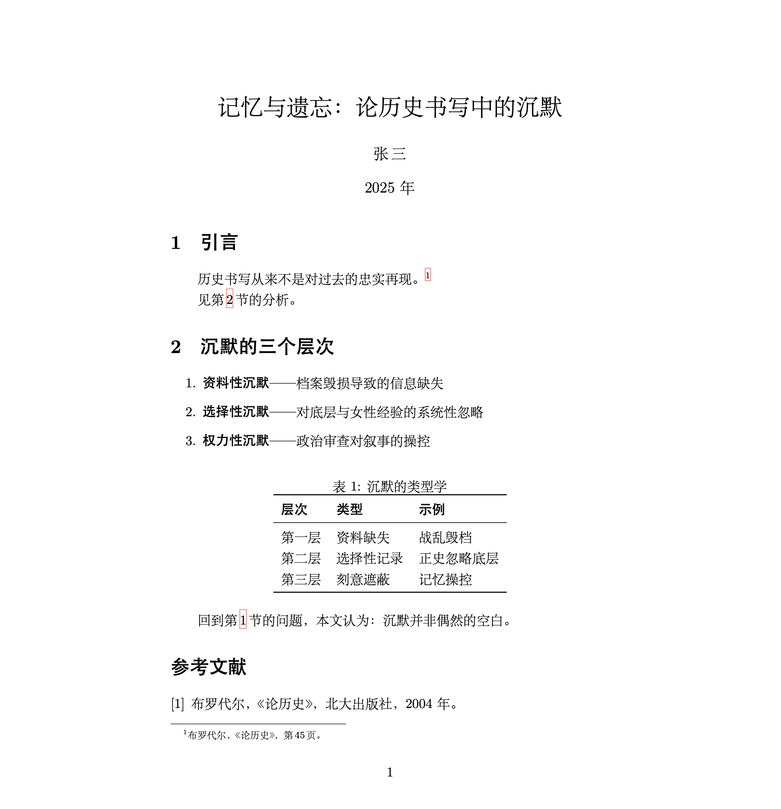

根据我的交往人群，读者诸君肯定有不少从事于人文学科或者广义的人文社科。在这样一个AI时代，一些只用多折腾一点点的信息技术或可以为大家提升不少的效率。我把我的全程经验写下来，也许能有一些帮助。

***

## 文章写作：$\LaTeX$

$\LaTeX$是一种排版方式，优势在于对于数学公式的支持，在理科学生学者那里广泛使用，我由于数理逻辑课作业的需求接触到了它。看起来和人文没有什么相干对不对？但是这种通过命令行来排版的语言在AI时代就具有了极高的优势。如果是Word写稿的工具流，我们只能把LLM（大语言模型）生成的文本复制粘贴到Word软件中再手动调整格式设置，更别提频繁出现又难以解决的排版问题。

但是，$\LaTeX$语言的所有格式安排都在源代码中通过文本得到了表达，也就是说，如果配置好了$\LaTeX$编译环境，AI可以全程操盘你的文章内容和排版，并且极易生成出美观学术的排版效果，这是我向人文相关学生推荐此的原因。（不过对有些社科和工科来说，对于多图表的文章写作不如Word方便，可以不用考虑）

此外，另一个主要的好处是，作为最主要的文献管理系统之一的Bibtex是基于$\LaTeX$的，无需另外的软件或配置就可以高效地进行文献管理、插入参考文献、交叉引用等功能，目录、页眉页脚、列表、小标题等格式设置也极其简便。

$\LaTeX$还支持模板，关于毕业论文的模板各高校都可找到，撰写时只用专注于内容文本，不必顾及格式排版问题。

关于$\LaTeX$环境的部署，我不在这里赘述，参看
[<u>这篇博文</u>](https://rosetears.cn/archives/73/)
即可，十分详细。

关于$\LaTeX$语言的学习，可以参看
[<u>一份（不太）简短的$\LaTeX$介绍</u>](https://texdoc.org/serve/lshort-zh-cn.pdf/0)，
比较全面，并且不必追求像学习自然语言那样，只要学会基本的语法，具体操作时遇到问题再随时参阅即可，毕竟主要任务可以交给AI。

以下是一个写作的例子，生成自AI，展示基本的工作方式。%后为代码注释：

```latex
\documentclass{article}
\usepackage{ctex}          % 中文排版引擎
\usepackage{booktabs}      % 三线表宏包
\usepackage{hyperref}      % 超链接与交叉引用

\title{记忆与遗忘：论历史书写中的沉默}
\author{张\,三}
\date{2025 年}

\begin{document}
\maketitle

\section{引言}
\label{sec:intro}

历史书写从来不是对过去的忠实再现。%
\footnote{布罗代尔，《论历史》，第\,45\,页。} % 脚注自动编号与排版

见第\,\ref{sec:body}\,节的分析。 % 交叉引用，序号自动更新

\section{沉默的三个层次}
\label{sec:body}

\begin{enumerate}
  \item \textbf{资料性沉默}——档案毁损导致的信息缺失
  \item \textbf{选择性沉默}——对底层与女性经验的系统性忽略
  \item \textbf{权力性沉默}——政治审查对叙事的操控
\end{enumerate}

\begin{table}[htbp]
  \centering
  \caption{沉默的类型学} % 表题与编号自动生成
  \begin{tabular}{lll}
    \toprule
    \textbf{层次} & \textbf{类型} & \textbf{示例} \\
    \midrule
    第一层 & 资料缺失 & 战乱毁档 \\
    第二层 & 选择性记录 & 正史忽略底层 \\
    第三层 & 刻意遮蔽 & 记忆操控 \\
    \bottomrule
  \end{tabular}
\end{table}

回到第\,\ref{sec:intro}\,节的问题，本文认为：沉默并非偶然的空白。

\begin{thebibliography}{9} % 参考文献环境
  \bibitem{b} 布罗代尔，《论历史》，北大出版社，2004 年。
\end{thebibliography}

\end{document}

```


完成后点击编译，就会得到成品文档：



成品pdf文档的脚注、交叉引用都是可点击跳转的。

***

## 从网页端到本地客户端：一种更高效的AI使用路径

目前常见的AI使用习惯，往往局限于各家大模型的官方网站或C端应用。这种方式虽然降低了初始门槛，但在处理复杂学术任务时，存在明显的功能与效率瓶颈。突破这一局限的方法是转向“本地客户端+API接口”的模式。
采用这种模式，能够直接获得几项核心优势：其一，能够体验Agent（智能体）直接操作电脑或执行代码的深度交互能力，而非仅仅进行文本问答；其二，在处理长篇学术写作时，本地客户端与LaTeX等本地编辑器的配合远比网页端粘贴复制高效；其三，成本完全可控，按Token计费的模式实现了真正的丰俭由人，避免了包月费用的浪费；其四，能够无障碍调用目前世界最先进的模型（如Claude 4.6 opus、GPT-5.4等）；最后，数据通过接口直接传输至本地，不再作为网页端的训练语料，学术资料的隐私得到了根本保障。

以下将介绍如何通过Cherry Studio这一工具，完成上述工作流的搭建。*然而，AI发展日新乐异，不久可能有更方便的方式，因此主要AI生成了此文章，我稍作润色，因此不够详细具体，大家可以自行查找教程。不过整个的工具选择是靠我个人不断试出来的最推荐方案。*

### 一、 Cherry Studio的下载与基本设置

Cherry Studio是一款开源的本地AI客户端，界面简洁，对学术文本处理十分友好。
1. **下载与安装**：访问Cherry Studio的GitHub发布页或官方网站，根据操作系统（Windows/macOS/Linux）下载对应的安装包，完成常规安装。
2. **基础界面认知**：打开软件后，左侧边栏通常分为“对话”、“助手”、“知识库”等模块。“对话”用于日常交互，“助手”允许预设特定的系统提示词（例如预设一个“西文文献翻译专家”或“LaTeX语法校对专家”），“知识库”则用于挂载本地的文件夹。
3. **外观与偏好**：在设置中，可以将界面语言调整为中文，并根据个人习惯调整字体大小与排版。

### 二、 API密钥的获取渠道

要脱离网页端，必须获取API密钥（API Key）。这里推荐两种获取途径，分别针对不同的使用需求。

#### 途径一：使用中转站（以cherryIN为例）

对于需要使用海外顶尖模型（如Claude系列、GPT系列）的情况，直接从海外官方获取API面临网络不稳定、需海外信用卡支付以及账号易封禁等现实困难。使用国内的中转站是更务实的选择。
cherryIN是一个运行稳定的中转站平台。其优势在于：网络节点部署在国内，访问极其稳定；支持微信或支付宝等常规国内支付方式；提供统一的OpenAI兼容格式接口，无需担心原厂封号风险。
在cherryIN注册账号并充值后，在控制台找到“API密钥”管理页面，点击创建新的密钥，将其复制并妥善保存（通常以`sk-`开头）。

#### 途径二：在阿里云获取API

如果主要使用国内的优秀模型（如MiniMax, GLM系列），阿里云是理想的选择。
1. 登录阿里云官网，搜索并进入“百炼”大模型平台。
2. 完成实名认证后，进入控制台。阿里云通常会赠送一定的免费额度供测试。
3. 在左侧导航栏找到“API-KEY管理”，点击创建新的API Key。系统会生成一段密钥字符，同样需要复制保存。

### 三、 在Cherry Studio中配置API

获取密钥后，需要将其配置到Cherry Studio中才能生效。
1. 点击Cherry Studio左下角的“设置”图标（齿轮状），选择“模型服务”。
2. **配置中转站（cherryIN）**：
   * 点击“添加模型服务商”，选择“OpenAI”格式（因为中转站均采用此兼容格式）。
   * 在“API Key”一栏，粘贴从cherryIN获取的密钥。
   * 在“API代理地址”（或API Base URL）一栏，填入cherryIN提供的接口地址（通常形如`https://api.cherryin.top/v1`，具体以平台说明为准）。
   * 点击“验证”或“获取模型列表”，若配置无误，下方会拉取出一长串可供使用的模型（如各种版本的Claude和GPT）。勾选需要的模型，点击保存。
3. **配置阿里云**：
   * 同样在“模型服务”中，点击添加，直接选择“阿里云百炼”。
   * 填入从阿里云复制的API Key，点击获取模型列表，勾选所需的通义千问模型并保存。
至此，已经可以在Cherry Studio的对话界面顶部，自由切换世界上目前最先进的各类大模型了。

### 四、 设置工作文件夹与完成工作流

配置好模型后，最后一步是建立针对学术研究的Agent工作流。
1. **设置工作文件夹（划定Agent权限）**：在本地建立一个专门的工作目录。在Cherry Studio建立智能体的时候就能看到，将路径指向该文件夹。这一步的核心意义在于划定安全边界：它定义了Agent可改写文件的范围。赋予Agent直接读写、修改该目录下文件的权限后，它便能真正代替人手去操作电脑处理文档，同时又被严格限制在此范围内，确保电脑其他区域的安全。
2. **挂载本地知识库**：在左侧选择“知识库”模块，创建知识库并拖入工作文件夹中的核心文献或TXT语料，软件会自动进行向量化处理，作为Agent的专属背景知识。
3. **实际应用场景**：
   * **LaTeX论文写作**：将正在撰写的.tex源文件保存在该工作文件夹中。在对话中直接向Agent下达指令：“阅读工作目录下的main.tex，修改第三段的逻辑结构，并直接覆盖保存”。Agent会在后台直接改写文件，省去了网页端来回复制粘贴的繁琐。
   * **文献资料处理**：要求Agent读取工作目录下的几份文本资料，提取特定主题的语料，并直接在工作目录内生成一份新的整理文档。

完成上述配置后，Cherry Studio配合API，实际上就相当于有了一个省心轻量的OpenClaw体验。它将原本繁复的本地环境配置、权限划分与模型调用整合在一个极简的客户端中，无需部署复杂的云端服务，打开软件就能让最先进的大模型直接在指定的文件夹里干活，成为一种真正贴合个人电脑的轻量化学术基础设施。

***

## Git项目管理

在学术资料的整理与文本撰写过程中，十分推荐了解并使用Git这款版本控制工具。它能够精准记录文件夹内所有文件的每一次修改历史，无论是增删段落还是调整结构，都会留下清晰的快照，随时可以回溯到任意历史状态，从根本上消除“初稿”“修改稿”“最终版”“绝对不改版”这类文件命名混乱的问题。Git的基础逻辑涉及一定的命令行操作，具有独立的学习门槛，难以在一篇短文中尽述，但将其作为一项长期技能去逐步掌握，对于任何涉及大量文本处理的工作而言，都是一项回报极高的基础性投入。